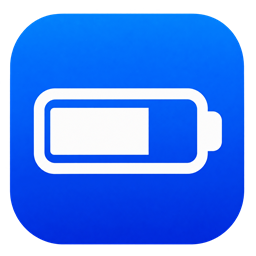

<p align="center">
  
</p>

# VoltPerch

A lightweight Windows app for checking peripheral connections and battery levels from your desktop or system tray.

VoltPerch brings supported keyboards, mice, controllers and Bluetooth devices into one list. It keeps the last valid battery reading when a device disconnects and clearly marks cached readings and system estimates.

[Download for Windows x64](https://github.com/WangHunter/VoltPerch/releases/latest) · [Release notes](CHANGELOG.md) · [MIT License](LICENSE)

[Features](#features) · [Compatibility](#device-compatibility) · [Install](#install-and-run) · [Build](#build-from-source) · [Contribute](CONTRIBUTING.md)

## Features

- Connection status, battery readings and charging information where the device exposes them.
- A compact tray panel that shows connected devices first, with an option to show all devices.
- A transparent battery-only tray icon with automatic device selection and an optional pinned device. Percentages appear in the device list, never on the tray icon.
- Last-known battery readings after disconnection, with an explicit not-live label.
- Low-battery notifications with repeat suppression.
- Light, dark and system themes, proportional window scaling, and keyboard-accessible controls.
- English by default, with a Simplified Chinese interface available in Settings.
- Remove devices through their details or right-click menu; restore them from Settings.
- Local data storage, no telemetry, no account requirement and no automatic update downloads.

VoltPerch saves the latest valid reading for each device. It does not record battery history or estimate remaining runtime.

## Requirements

- Windows 10 version 2004 or later, or Windows 11.
- An x64 PC with the relevant device drivers installed.
- A supported device and connection mode. Bluetooth support depends on what Windows and the device report.

Portable release builds include the .NET runtime. You do not need to install a separate runtime or SDK to use them.

## Device compatibility

Support is specific to a device, firmware and connection mode. This is not a complete inventory of every peripheral attached to Windows.

| Device or channel | Implemented support | Limits and verification scope |
| --- | --- | --- |
| VGN V98pro V2, 2.4 GHz receiver | Battery percentage, charging information, device-response status and wake-triggered refresh | Exercised on the target model, including receiver removal and reinsertion. A silent receiver/device exchange may not distinguish sleep from power-off. |
| SteelSeries Rival 650, wired USB | Battery percentage, charging information and connection status | Exercised on the target model in wired mode. |
| SteelSeries Rival 650, 2.4 GHz receiver | A model-specific battery query is implemented | Wireless receiver behavior still needs controlled hardware verification. Wired results do not establish wireless support. |
| Xbox controllers through Windows.Gaming.Input | Per-controller battery reports and multiple-controller display | Capacity ratios are labeled as system estimates, not exact percentages measured by the controller. Receiver mode has been exercised; controlled power-off/reconnect testing remains incomplete. |
| Xbox controllers through XInput | Coarse Empty / Low / Medium / Full battery levels as a fallback | These levels are never silently converted into exact percentages. Ambiguous device identity remains unconfirmed. USB power alone does not prove charging or a full battery. |
| Classic Bluetooth devices with a Windows battery property | Windows connection information and the battery value associated with the device, including HFP service nodes | Availability and freshness depend on Windows and the device. The value is Windows' last report; there is no dependable device sampling timestamp. This path has been exercised with JBL TUNE760NC. |
| Other classic Bluetooth devices | Known devices can appear with their connection state | A connected device may expose no usable battery value. |
| BLE/GATT battery service, separate earbud/case readings, other proprietary 2.4 GHz protocols | Not implemented | A generic Bluetooth listing does not imply battery support for these channels. |

Automated checks validate parsing, state transitions and display rules. They do not establish compatibility with hardware that has not been exercised. To request another device, use the [device support form](https://github.com/WangHunter/VoltPerch/issues/new?template=device_support.yml).

## Install and run

1. Download the Windows x64 portable ZIP from [Releases](https://github.com/WangHunter/VoltPerch/releases) .
2. Extract the whole archive to a writable folder, for example `D:\Tools\VoltPerch`.
3. Run `VoltPerch.exe` from that folder. Keep the accompanying files together.

The app opens its main window. Closing the window sends it to the tray by default; use **Exit** in the tray icon's right-click menu to quit completely. Launching it again brings up the existing instance.

### Language and appearance

Open **Settings > General > Language** to choose English or Simplified Chinese. English is the default. Use **Theme** to choose Light, Dark or Follow system. Documentation and source comments are maintained in English.

### Device readings

- A dash means that no valid battery reading is available. It does not mean an empty battery.
- An approximation mark identifies a system estimate. Coarse battery levels remain labeled as levels.
- Disconnected devices retain their last valid reading, clearly marked as not live.
- A receiver being present does not by itself make its peripheral connected.
- Some sleeping devices must be awakened before a new reading is possible.

Click a device for connection, transport, reading and support details. The tray panel opens with connected devices only; **Show all** includes offline and unconfirmed devices. Hovering over the tray icon does not show a device tooltip.

### Notifications

The default low-battery threshold is 20%, with sound disabled. After the first alert, another requires a further drop of at least 5 percentage points and a gap of at least 30 minutes. Charging devices, cached readings, system estimates and coarse battery levels do not trigger percentage-threshold notifications.

Automatic tray selection prefers current device-reported percentages, then system estimates, then coarse levels. Offline readings are excluded. You can also pin a specific device in its details.

### Remove and restore

Right-click a device and choose **Remove device**, or use the same action in its details. This hides it in VoltPerch and clears its saved battery and alert state. Windows pairing and the physical connection are unaffected.

Restore it under **Settings > Devices & data > Removed devices**. Restoring starts a fresh read; previously cleared battery values are not recovered.

### Upgrade

1. Choose **Exit** from the tray menu and confirm the app has stopped.
2. Back up the `data` folder next to `VoltPerch.exe`.
3. Extract the new release into the same folder, replacing application files while preserving `data`.
4. Start `VoltPerch.exe` again.

Do not replace files while the app is running. If moving to a new folder, move `data` with the app to retain settings and saved readings. Re-enable launch at sign-in from the new location if needed.

## Data and privacy

VoltPerch keeps data beside the executable:

| File | Purpose |
| --- | --- |
| `data/settings.json` | Language, theme, refresh and notification preferences |
| `data/devices.json` | Device information and the latest valid battery reading |
| `data/identities.json` | Persistent device identity mappings |
| `data/removed-devices.json` | Devices hidden from the app |
| `data/alerts.json` | Notification state used to suppress repeat alerts |

These files can contain device identifiers and personal device names. Review and redact them before sharing an issue or diagnostic report. The app does not upload the device list or send telemetry. Battery queries do not change lighting, macros, key bindings or firmware. Keyboard wake detection uses device identity from raw-input headers; it does not record keystrokes or typed text.

## Build from source

Install the .NET 10 SDK on Windows, then run from the repository root:

```powershell
dotnet publish src/BatteryDesk/BatteryDesk.csproj -c Release -r win-x64 --self-contained true -o artifacts/publish
```

Build output is written to `artifacts/publish`. The source directory keeps its original `BatteryDesk` name; the application is branded VoltPerch.

### Run checks

```powershell
dotnet run --project tools/CoreChecks/CoreChecks.csproj -c Release
dotnet run --project tools/WakeChecks/WakeChecks.csproj -c Release
dotnet run --project tools/XInputChecks/XInputChecks.csproj -c Release
dotnet run --project tools/WgiChecks/WgiChecks.csproj -c Release
dotnet run --project tools/BluetoothChecks/BluetoothChecks.csproj -c Release
dotnet run --project tools/LocalizationChecks/LocalizationChecks.csproj -c Release
```

These checks cover state and cache policies, wake/connection refresh behavior, controller parsing and mapping, Bluetooth property ownership, and localization. Separate device probes and physical reconnect tests require suitable hardware; running the checks alone does not verify those paths on a new machine.

## Contributing

Bug reports, reproducible compatibility findings and focused patches are welcome. Read [CONTRIBUTING.md](CONTRIBUTING.md) before adding a protocol or changing battery semantics. Use the [bug report form](https://github.com/WangHunter/VoltPerch/issues/new?template=bug_report.yml) for defects.

## License and acknowledgments

VoltPerch is licensed under the [MIT License](LICENSE). Third-party protocol references and bundled runtime notices are documented in [THIRD_PARTY_NOTICES.txt](THIRD_PARTY_NOTICES.txt) and the `licenses` directory.

VoltPerch is independent of the hardware manufacturers and projects referenced in its compatibility notes.
